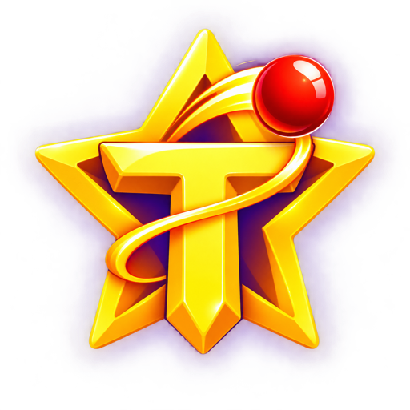

# Yıldız Savaşı

Solar2D ile geliştirilen, yalnızca dikey modda çalışan mobil uzay oyunu. Oyuncu gemiyi meteorların arasından yönlendirir, lazerle meteorları vurur ve her bölümde daha zorlu dalgaları tamamlar.



## Oyun akışı

- Meteorları vurarak skor ve kombo kazanılır.
- Gemi meteor veya duvarla çarpıştığında bir can kaybeder ve kısa bir tamir sürecine girer.
- Bölüm tamamlanınca sonraki bölüm otomatik açılır.
- Yeni Oyun ekranında üç gemiden biri seçilir; gemilerin lazer dolum hızları ve görsel renkleri farklıdır.
- Kozmik Komutan hızlı ve düz Y ekseni lazeri kullanır; tüm gemilerde temel lazer atışı güvenlidir.
- Meteorların dönme hızı artırılmıştır; her 10 saniyede bir küçük düşman gemisi yukarıdan gelir ve aşağı doğru ateş eder.
- Düşman gemileri lazerle vurulabilir; her biri sabit 150 puan verir ve üç renkten bir `+` bonusu bırakır: mavi daha hızlı lazer, yeşil ek can, sarı 8 saniyelik kalkan sağlar.
- Bölüm 4'te 75 meteor tamamlandıktan sonra hareket eden bir boss ortaya çıkar; boss yenilmeden oyun bitmez.
- Yerel kayıt, yüksek skorlar, başarımlar ve günlük görevler cihazda tutulur.

## Bölümler

| Bölüm | Hedef meteor | Dalga | Özel kural |
| --- | ---: | ---: | --- |
| 1 | 50 | 5 | Temel meteor akışı |
| 2 | 75 | 5 | Artan meteor hızı |
| 3 | 100 | 5 | Duvarsız meteor bölümü |
| 4 | 75 | 5 | Aşağı inen duvarlar ve güçlendirmeler |

Bölüm 4 duvarlarının iniş hızı %40 azaltılmış, duvarlar arasındaki süre üç katına çıkarılmıştır.

## Kontroller

- `◀` ve `▶`: Gemiyi sağa-sola hareket ettirir. Basılı tutularak sürekli hareket sağlanır.
- `ATEŞ`: Lazer ateşler.
- Gemi ayrıca sürüklenerek yatayda kontrol edilebilir.

Oyun tüm ekranlarda yalnızca dikey (`portrait`) yönü destekler.

## Projeyi çalıştırma

1. [Solar2D](https://solar2d.com/) Simulator’ı kurun.
2. Solar2D Simulator’da bu klasörü açın.
3. `main.lua` dosyasını çalıştırın.

Yerel Lua doğrulaması için:

```bash
luac -p *.lua
```

## Proje yapısı

- `main.lua`: Uygulama başlangıcı ve genel ses ayarı.
- `menu.lua`: Ana menü ve oyun seçenekleri.
- `gemi_sec.lua`, `gemi_secimi.lua`: Yeni oyun gemi seçimi ve gemi denge ayarları.
- `oyun.lua` – `oyun4.lua`: Bölüm oynanışları.
- `oyun_ayar.lua`: Bölüm hedefleri ve denge ayarları.
- `oyun_kayit.lua`: Yerel devam kaydı.
- `oyun_meta.lua`: Başarımlar ve günlük görevler.
- `sonuc.lua`, `yuksek_skor.lua`: Sonuç ve yüksek skor ekranları.
- `destek.lua`: Oyun içi destek/iletişim sayfası.

## Gizlilik ve iletişim

- Gizlilik politikası: <https://ttaskesen.github.io/benimStarApp/privacy-policy/>
- Google Play yayın kontrolü: [GOOGLE_PLAY_RELEASE.md](GOOGLE_PLAY_RELEASE.md)
- Geliştirici: **Taskesen**
- E-posta: **taskesen@msn.com**

Oyun kişisel veri toplamaz; kayıtlar cihazın yerel depolamasında tutulur.

## Sürüm

Mevcut geliştirme sürümü: **v0.0.11**
